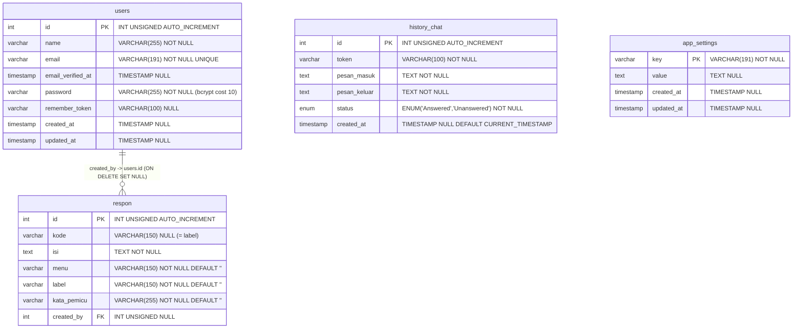
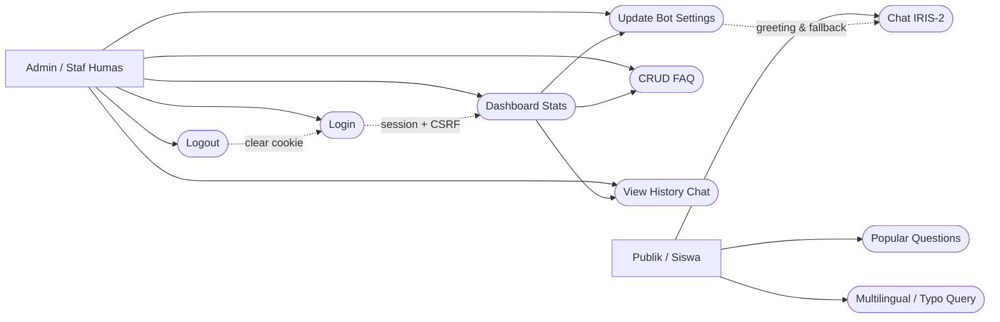
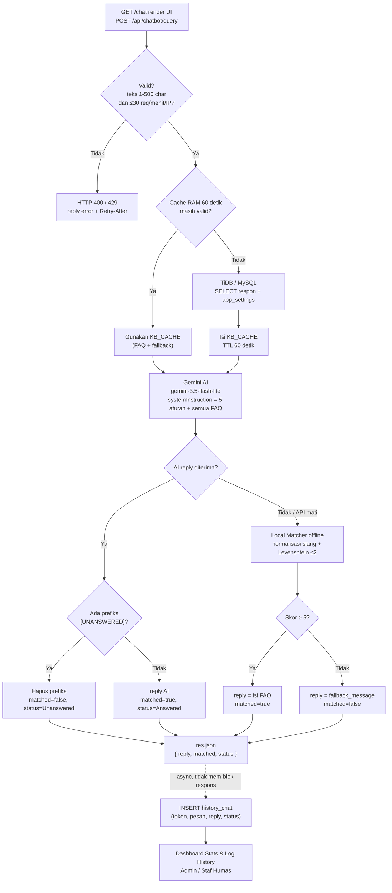

# IRIS-2 — AI-Powered School Information Chatbot

**SMKN 2 Purwakarta · Chatbot Akademik + Portal Admin**

IRIS-2 (*Interactive Response & Information System*) adalah aplikasi web chatbot yang memberikan informasi sekolah secara real-time kepada siswa, orang tua, dan masyarakat. Sistem terdiri dari dua bagian:

1. **Antarmuka chat publik** (`/chat`) — pengunjung bertanya tanpa login. Jawaban dihasilkan oleh Google Gemini yang dibatasi oleh basis pengetahuan FAQ, dengan mesin pencocokan lokal sebagai cadangan saat AI tidak tersedia.
2. **Portal admin** (`/admin/*`) — administrator mengelola FAQ, membaca log percakapan, mengatur sapaan/pesan fallback, dan melihat statistik.

Dokumen pendukung penilaian UKK:

- `PRESENTATION_GUIDE.md` — cheat sheet sidang (arsitektur, routes, keamanan, auth, fitur, alasan tech stack).
- `QA_TEST_CASE.md` — 15 test case fungsional & keamanan.
- `db_chatbot.sql` — export lengkap struktur + data dummy (termasuk foreign key).

---

## Daftar Isi

- [Tech Stack](#tech-stack)
- [Struktur Folder (MVC)](#struktur-folder-mvc)
- [Instalasi Lokal](#instalasi-lokal)
- [Konfigurasi `.env`](#konfigurasi-env)
- [Database Schema](#database-schema)
- [Daftar Akun Uji Coba](#daftar-akun-uji-coba)
- [Fitur Utama](#fitur-utama)
- [Dokumentasi API](#dokumentasi-api)
- [Keamanan](#keamanan)
- [Developer Credit](#developer-credit)

---

## Tech Stack

| Layer | Teknologi | Catatan |
|---|---|---|
| Runtime | Node.js (CommonJS) | Async I/O untuk query DB + panggilan AI |
| Framework | Express.js 5.x | Middleware pipeline transparan di `server.js` |
| Database | TiDB Cloud Serverless (MySQL-compatible) via `mysql2/promise` | SSL wajib, connection pool terpusat |
| Model / ORM | Native SQL + prepared statement (`?`) | Tidak memakai ORM berat |
| View | EJS + Tailwind CSS (CDN) | Server-side rendering, tanpa build step |
| Controller | `controllers/*.js` | 5 controller: auth, admin, faq, setting, chat |
| AI | `@google/genai` — `gemini-3.5-flash-lite` | `systemInstruction` berisi seluruh FAQ + aturan percakapan |
| Auth hash | `bcryptjs` (cost 10) | Dipakai seed & verifikasi login |
| Session | `cookie-session` | Cookie signed `smekda_session`, 24 jam |
| Konfigurasi | `dotenv` | Semua kredensial di `.env` |
| Deploy | Vercel (`vercel.json`) | Serverless: `app` di-export, port tidak di-bind |

> Catatan: README versi lama menyebut `express-session`, `connect.sid`, dan chat "belum dibuat". Implementasi terkini memakai `cookie-session` dan chatbot sudah aktif penuh.

---

## Struktur Folder (MVC)

```
chatbot-smekda/
├── server.js                      # Entry point: middleware, routes, guard, CSRF, rate limit
├── config/
│   └── db.js                      # MODEL: pool mysql2/promise + SSL TiDB (single source of truth)
├── controllers/                   # CONTROLLER
│   ├── authController.js          # Login, logout, dummy-hash timing defense
│   ├── adminController.js         # Dashboard, history log, support
│   ├── faqController.js           # CRUD respon + LEFT JOIN users (relasi created_by)
│   ├── settingController.js       # app_settings (greeting & fallback)
│   └── chatController.js          # Halaman chat, AI + fallback matcher, KI cache, logging
├── views/                         # VIEW (EJS + Tailwind)
│   ├── user/chat.ejs              # Antarmuka chat siswa
│   ├── admin/
│   │   ├── login.ejs
│   │   ├── dashboard.ejs
│   │   ├── faq.ejs
│   │   ├── history.ejs
│   │   ├── settings.ejs
│   │   ├── support.ejs
│   │   └── partial/faq-pagination.ejs
│   └── partials/
│       ├── admin-header.ejs       # Sidebar + navigasi
│       └── admin-footer.ejs       # Modal konfirmasi & swipe logout
├── public/                        # Static: JS, CSS, images/smekda.png
├── scripts/
│   ├── seed-faq.js                # Seed 22 FAQ terverifikasi (profil, PPDB, jurusan, ekskul)
│   ├── migrate-faq-schema.js      # Migrasi skema FAQ lama (idempotent)
│   ├── migrate-chat-log-status.js # Migrasi kolom status history_chat
│   └── ensure-chat-tables.js      # Penjamin tabel chat
├── seed.js                        # Bootstrap skema + admin + settings + FAQ + history (FK created_by)
├── db_chatbot.sql                 # EXPORT: CREATE TABLE + INSERT dummy + FK
├── PRESENTATION_GUIDE.md          # Cheat sheet sidang UKK
├── QA_TEST_CASE.md                # 15 test case QA
├── vercel.json                    # Konfigurasi serverless
├── .env                           # Kredensial (JANGAN di-commit)
└── package.json
```

**Alur MVC:** `Browser → Express routes (server.js) → middleware (session, CSRF, guard) → Controller → config/db.js (pool) → TiDB/MySQL → EJS View → Browser`.

---

## Instalasi Lokal

```bash
# 1. Clone & masuk folder
git clone <repository-url>
cd chatbot-smekda

# 2. Install dependency
npm install

# 3. Salin/konfigurasi .env (lihat bagian Konfigurasi)
#    Pastikan SESSION_SECRET minimal 32 karakter.

# 4. Buat skema + data awal (idempotent, bisa dijalankan ulang)
node seed.js

# Alternatif: import export SQL mentah (MySQL CLI)
mysql -u root -p < db_chatbot.sql

# 5. Jalankan server
node server.js
# IRIS-2 server listening on http://localhost:3000
```

Buka:

- Chat siswa: **http://localhost:3000/chat**
- Login admin: **http://localhost:3000/admin/login**

Jika skema lama masih aktif, jalankan `node scripts/migrate-faq-schema.js` terlebih dahulu (idempotent). `node seed.js` juga otomatis menambahkan kolom `created_by` beserta foreign key-nya ke tabel `respon` yang sudah ada.

---

## Konfigurasi `.env`

| Variabel | Wajib | Fungsi | Contoh |
|---|---|---|---|
| `DB_HOST` | Ya | Host TiDB/MySQL | `gateway01.ap-northeast-1.prod.aws.tidbcloud.com` |
| `DB_PORT` | Ya | Port database | `4000` |
| `DB_DATABASE` | Ya | Nama skema (default `db_chatbot`) | `db_chatbot` |
| `DB_USERNAME` | Ya | User database | `2G7pYBQQKdxNeLY.root` |
| `DB_PASSWORD` | Ya | Password database | `********` |
| `DB_SSL_CA` | Tidak | Path CA private/self-signed | `./certs/tidb-ca.pem` |
| `DB_POOL_LIMIT` | Tidak | Batas koneksi pool (default 5) | `5` |
| `DB_CONNECT_TIMEOUT` | Tidak | Timeout handshake TLS (default 20000 ms) | `20000` |
| `SESSION_SECRET` | Ya | Kunci penandatanganan cookie, **minimal 32 karakter** | string acak panjang |
| `GEMINI_API_KEY` | Ya untuk AI | Kunci Google AI Studio | `AQ...` |
| `GEMINI_MODEL` | Tidak | Override model (default `gemini-3.5-flash-lite`) | `gemini-3.5-flash-lite` |
| `PORT` | Tidak | Port HTTP lokal (default 3000) | `3000` |
| `NODE_ENV` | Tidak | `production` mengaktifkan cookie `secure` | `production` |

> **Tips:** password yang mengandung `#` atau spasi harus dibungkus tanda kutip ganda, jika tidak akan terpotong sebagai komentar. Jangan pernah commit `.env` — sudah masuk `.gitignore`.

---

## Database Schema

**Relasi:** `respon.created_by → users.id` dengan `ON DELETE SET NULL`. Artinya setiap FAQ mencatat admin pembuatnya; jika akun admin dihapus, FAQ **tetap ada** dan kolom `created_by`-nya menjadi `NULL`. Ini diverifikasi dengan query JOIN aktif di `faqController.index`:

```sql
SELECT r.id, r.menu, r.label, r.kata_pemicu, r.isi, u.name AS authorName
FROM respon r
LEFT JOIN users u ON r.created_by = u.id
WHERE r.menu LIKE ?
ORDER BY r.menu ASC, r.label ASC, r.id ASC
LIMIT ? OFFSET ?
```

### Ringkasan tabel

| Tabel | Kolom kunci | Fungsi |
|---|---|---|
| `users` | `id` (PK), `email` (UNIQUE), `password` | Akun administrator |
| `respon` | `id` (PK), `created_by` (FK → users.id) | FAQ + kata pemicu + jawaban |
| `app_settings` | `key` (PK) | `greeting_message`, `fallback_message` |
| `history_chat` | `id` (PK), `token`, `status` | Log semua percakapan (Answered / Unanswered) |

Export SQL lengkap tersedia di `db_chatbot.sql` (CREATE TABLE + PRIMARY KEY + FOREIGN KEY + INSERT dummy untuk keempat tabel).

---

## Daftar Akun Uji Coba

| No | Nama | Email | Password | Role |
|---|---|---|---|---|
| 1 | Super Admin IRIS-2 | `admin@smkn2purwakarta.sch.id` | `Admin123!` | Administrator (akses penuh) |
| 2 | Butsaina Dzurwa | `butsaina@smkn2purwakarta.sch.id` | `Admin123!` | Operator konten |
| 3 | Admin Humas SMKN 2 | `humas@smkn2purwakarta.sch.id` | `Admin123!` | Staf Humas |

> Akun dibuat oleh `node seed.js` dan juga tersedia di `db_chatbot.sql`. Password disimpan sebagai bcrypt hash (cost 10), bukan plaintext.

---

## Fitur Utama

- **Chatbot IRIS-2** — jawaban dari Gemini 3.5 Flash Lite yang di-grounding pada seluruh baris FAQ melalui `systemInstruction` (5 aturan permanen: bahasa, sapaan, profanity, pengetahuan sekolah, out-of-scope).
- **Fallback lokal** — normalisasi slang (`sp`, `kepsek`, `kpsk`, `smekda`, `jur`, `jrsn`, `syrt`, `dimn`) + jarak Levenshtein ≤ 2, sehingga bot tetap menjawab saat API mati.
- **Cache pengetahuan 60 detik** — mengurangi round-trip TiDB per request.
- **Log percakapan async** — setiap pertanyaan tercatat di `history_chat` dengan token sesi.
- **CRUD FAQ** — create/read/update/delete dengan pencarian, filter kategori, dan pagination.
- **Dashboard** — total chat, total keyword, jumlah pertanyaan belum terjawab, aktivitas terakhir.
- **Log History** — audit trail lengkap dengan pencarian dan pagination.
- **Settings** — mengubah greeting & fallback message (whitelist key).
- **Rate limiting** — maksimal 30 pertanyaan per menit per IP.

---

## Dokumentasi API

| Method | Path | Handler | Proteksi |
|---|---|---|---|
| GET | `/` | redirect → `/chat` | — |
| GET | `/chat` | `chatController.page` | publik |
| POST | `/api/chatbot/query` | `chatController.query` | rate limiter |
| GET | `/admin/login` | `authController.showLogin` | redirect jika sudah login |
| POST | `/admin/login` | `authController.login` | CSRF |
| GET / POST | `/admin/logout` | `authController.logout` | POST: CSRF |
| GET | `/admin/dashboard` | `adminController.dashboard` | session admin |
| GET | `/admin/faq` | `faqController.index` (LEFT JOIN) | session admin |
| POST | `/admin/faq/store` | `faqController.store` | session + CSRF |
| POST | `/admin/faq/:id` | `faqController.update` | session + CSRF |
| POST | `/admin/faq/:id/delete` | `faqController.destroy` | session + CSRF |
| GET | `/admin/history` | `adminController.history` | session admin |
| GET | `/admin/settings` | `settingController.index` | session admin |
| POST | `/admin/settings/update` | `settingController.update` | session + CSRF |
| GET | `/admin/support` | `adminController.support` | session admin |
| GET | `/admin/logs` | alias history | session admin |

---

## Keamanan

- **Password:** bcryptjs + salt per user; dummy hash cost-12 mencegah user enumeration lewat timing.
- **Session:** cookie `smekda_session` signed dengan `SESSION_SECRET`, `httpOnly`, `sameSite: lax`, `secure` di production.
- **CSRF:** token 32-byte per session, diverifikasi dengan `crypto.timingSafeEqual` pada semua POST admin.
- **SQL Injection:** semua input memakai prepared statement `?`; nama kolom dari whitelist.
- **XSS:** EJS `<%= %>` melakukan escape; data untuk `onclick` di-escape dulu oleh `jsAttr()`; balasan chat memakai `textContent`, bukan `innerHTML`.
- **Anti-cache:** header `no-store` pada seluruh `/admin` mencegah dashboard muncul lagi lewat tombol Back setelah logout.
- **Relasi aman:** `ON DELETE SET NULL` menjaga FAQ tetap ada saat admin dihapus.
- **Graceful shutdown:** `SIGINT`/`SIGTERM` menutup pool setelah request selesai.

---

## Developer Credit

Dikembangkan oleh **Butsaina Dzurwa M.** — siswa kelas 12 RPL SMKN 2 Purwakarta.
Kontak: butsaina2134@gmail.com · Instagram: [@bbutsaina](https://instagram.com/bbutsaina)

---

## System Design Diagrams (ERD, Use Case & Flowchart)

### 1. Entity Relationship Diagram (ERD)

Diagram ini mengikuti definisi kolom persis di `db_chatbot.sql`. Tipe data ditulis dalam bentuk dasar Mermaid; keterangan di dalam tanda kutip memuat informasi MySQL lengkap (mis. `UNSIGNED`, panjang `VARCHAR`, nilai `ENUM`).



> Catatan: sesuai `db_chatbot.sql`, primary key `app_settings` adalah kolom **`key`** (`VARCHAR(191)`), bukan `id`. Relasi satu-satunya antar tabel adalah `respon.created_by → users.id` dengan `ON DELETE SET NULL`.

### 2. Use Case Diagram (Flowchart representation)



### 3. System Flowchart — End-to-End Chat Request


